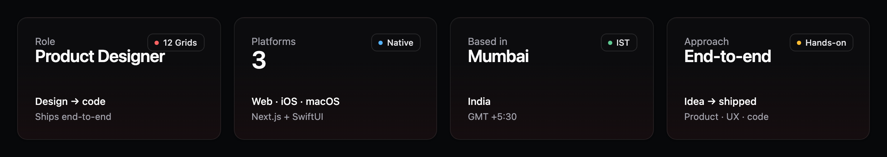
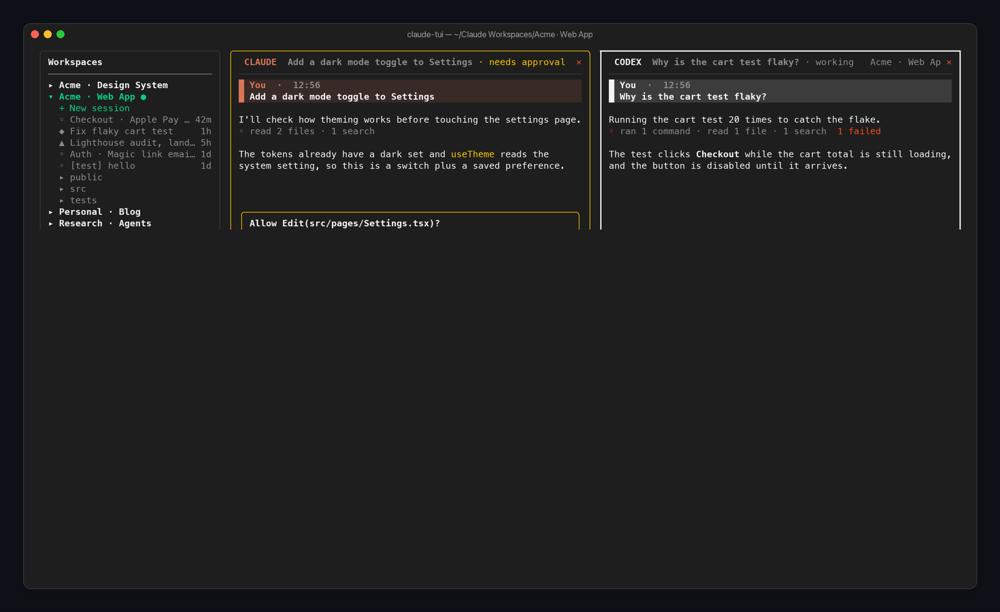
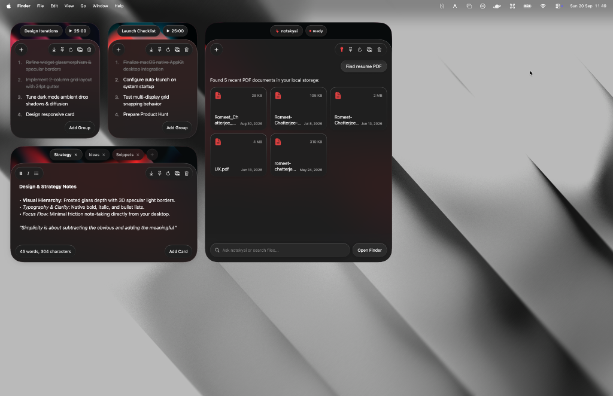
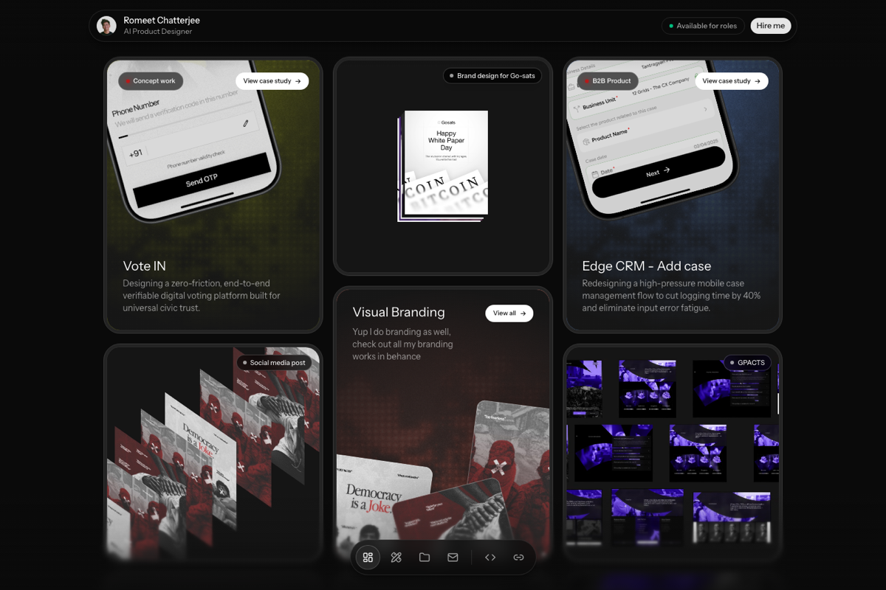
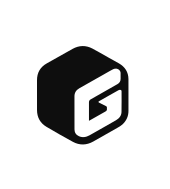

 

  

<h3 align="center">Romeet Chatterjee</h3>

Product designer who ships. I take products from a rough idea to real, polished code across <b>web</b>, <b>iOS</b> and <b>macOS</b>.

 

   &nbsp;

   &nbsp;

<h1 aria-hidden="true"></h1>

 

  

 

## ✨ About

- **Design to code.** I do the product thinking and the UX, then build it myself, so what ships is what was designed.
- **Native where it matters.** Next.js and React on the web, SwiftUI on iOS and macOS.
- **Built with AI agents.** I work alongside coding agents every day, and I build tools to make that faster.

## 🚀 Projects

<table>
  <tr>
    <td width="50%" valign="top">
      
      <h3><a href="https://github.com/romeet9/claude-tui">claude-tui</a></h3>
      A full-screen terminal workspace for coding agents. Run Claude Code, Codex and Antigravity side by side.
        
       
    </td>
    <td width="50%" valign="top">
      
      <h3><a href="https://github.com/romeet9/Notsky">Notsky</a></h3>
      Liquid Glass desktop notes and a local AI workspace for macOS, with focus timers and on-device document search.
        
       
    </td>
  </tr>
  <tr>
    <td width="50%" valign="top">
      
      <h3><a href="https://github.com/romeet9/romeet-portfolio">Portfolio</a></h3>
      My design portfolio, built as a product dashboard: web, iOS and macOS case studies. Live at <a href="https://romeet.vercel.app">romeet.vercel.app</a>.
        
       
    </td>
    <td width="50%" valign="top" align="center">
        
      
        
      <h3><a href="https://github.com/romeet9/greenloom-ui">Loom UI</a></h3>
      The design system and accessible component library for Green Loom, for React and React Native.
        
       
    </td>
  </tr>
</table>

## 🧰 Toolbox

| | |
| --- | --- |
| **Design** | Figma · Framer · prototyping · product thinking |
| **Web** | Next.js · React · TypeScript · Tailwind · Firebase |
| **Apple** | SwiftUI · Swift · SwiftData |
| **AI** | Claude Code · Codex · Antigravity · MCP |

## 📫 Get in touch

The best way to reach me is [LinkedIn](https://www.linkedin.com/in/romeet-chatterjee). More of my work, including the projects that aren't public, is on my [portfolio](https://romeet.vercel.app).

<h1 aria-hidden="true"></h1>

Always building something. 🛠️

